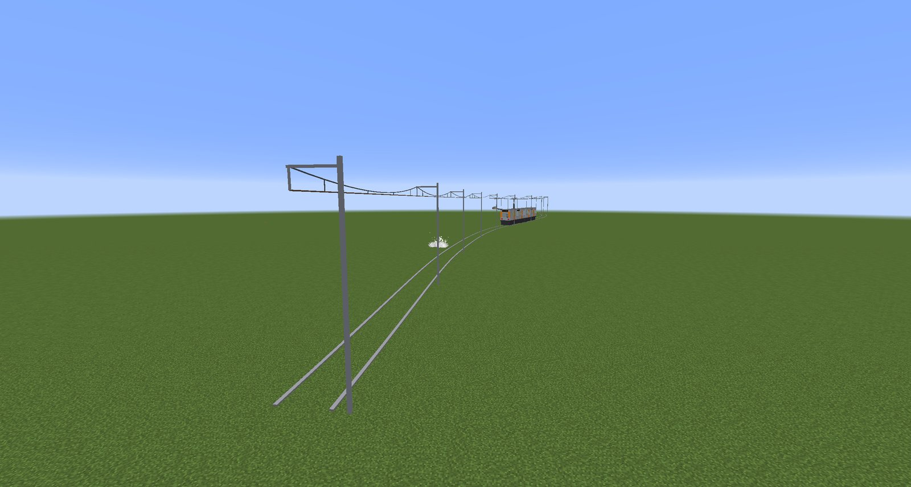
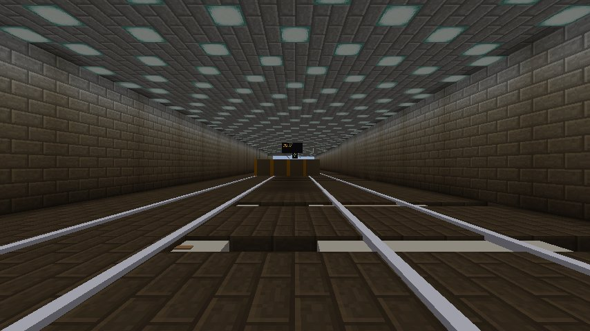

# Track styles

A style decides what a section **looks** like. It never touches the spline, the arc-length table or
the physics — a train runs identically on every style.

```
/rcmc style <sectionId> <style> [wireHeight | left|right]
```

or cycle through the transit looks by pointing at a section with the
[transit tool](items-and-blocks.md#transit-tool) in track-style mode.

Style is **per section**, so an electrified metro alignment and a bare coaster circuit coexist in
one park. An unrecognised style id degrades to the coaster look rather than failing to render.

## The styles

| Id | Gauge | Ballast | Overhead |
| --- | --- | --- | --- |
| `coaster` | Narrow | No | None |
| `transit` | Wide (2.8) | Yes | None |
| `transit-catenary` | Wide (2.8) | Yes | Masts, messenger and contact wire |
| `transit-portal` | Wide (2.8) | Yes | Two-legged gantries carrying the same wires |
| `transit-tunnel` | Wide (2.8) | Yes | Rigid conductor bar, no sag |
| `transit-third-rail` | Wide (2.8) | Yes | None: a conductor rail beside the track |

### `coaster`

The default, and the absence of a style rather than a style — narrow gauge, light rail, no ballast,
no electrification. This is what track is until you change it.

### `transit`

Heavy rail: **2.8 blocks between railheads**, longer ties, a heavier spine, visibly thicker rail,
and a ballast bed swept beneath the spine.

The gauge looks *narrower than the train*, which is correct and deliberate — real metro bodies are
around 3.05 m wide on 1.435 m gauge, and reproducing that ratio is what makes the stock read as
overhanging its track rather than balancing on it.

### `transit-catenary`



Adds a mast with a bracket arm every **24 blocks**, a contact wire swept along the alignment, a
parabolic-sag messenger wire above it with droppers between the two, and a registration drop tying
the contact wire to the hardware at each mast.

Masts hang off the track's own frames, so elevated and banked track carries its electrification
with it, and a closed circuit's spans wrap seamlessly.

### `transit-portal`

The same wires on two-legged gantries rather than single masts — what a multi-track alignment
actually uses.

### `transit-tunnel`



A **rigid conductor bar** with clamp stubs, no sag, hung at 7.0 blocks by default. Rigid overhead
conductor rail is what real tunnels use precisely because it needs no sag clearance.

### `transit-third-rail`

```
/rcmc style 13 transit-third-rail
/rcmc style 13 transit-third-rail left
```

The subway look: nothing overhead, and a **conductor rail beside the running rails**, 2.1 blocks out
from the centreline with its top just above railhead height, on insulator chairs every two blocks
under a timber cover board. It suits low tunnels, which have no room for a wire over the train.

- **Side.** The rail runs on the **right**, looking along the section in the direction its distances
  increase, unless the style says `left` (stored as `transit-third-rail-left`).
- **Platforms.** At a berth whose doors open on one side, the rail moves to the other side, so it is
  never at the platform edge. It changes sides 100 blocks before the stop point and back 100 blocks
  after it, which covers a long train standing at the berth from either direction. A berth with doors
  on both sides leaves the rail where it is.
- **Breaks.** Every change of side leaves a three-block gap between the ramped ends of the two
  lengths, as real third rail does. The rail also stops 8 blocks short of any switch a section end
  belongs to, clear of the points.
- **Trains.** Metro cars on a third-rail section carry collector shoes on both sides of each truck,
  riding on the rail's top, and no pantograph. Both sides, because the rail swaps sides at stations;
  real third-rail stock is built the same way.

The rail follows the stations and switches as they change: adding a berth moves it without the track
being edited.

## Wire height

```
/rcmc style 3 transit-catenary 12
```

| | |
| --- | --- |
| Default contact wire | **10 blocks** |
| Range | **7 – 15 blocks** |
| Default tunnel conductor | **7.0 blocks** |

The height rides on the **style id itself** as a numeric suffix — `transit-catenary-12`. That is how
a per-section value is stored without adding a field to every section and a version bump to the
track codec. A trailing number is a height; `transit-catenary` never parses as `transit`.

**7 blocks is a floor, not a preference.** A metro car's roof sits at 5.95 and its pantograph base
at 6.13, so a 6-block wire would pass straight *through* the hardware meant to collect from it. The
clearance check measures against the pantograph rather than the roof, because clearing the roof was
never the real requirement.

The **pantograph derives its reach from the wire**, so it stretches to meet 7 blocks or 15 rather
than carrying its own constant. That retires a "one measurement in two places" hazard that had
already produced one stale comment in the source.

`transit` and `transit-third-rail` carry no wire, so they take no height. Passing one to `transit`
is an error rather than a silent no-op; `transit-third-rail` takes `left` or `right` in its place.

## Colour

Independent of style. Four parts, twelve colours, per section:

| Part | |
| --- | --- |
| Rails | `steel` `graphite` `white` `red` `orange` `yellow` `green` `teal` `blue` `purple` `pink` `brown` |
| Spine | " |
| Ties | " |
| Supports | " |

Painted with the [track editor](items-and-blocks.md#track-editor) — ++c++ cycles the colour, ++v++
cycles which part it applies to. Trains are painted separately with
[`/rcmc paint`](commands.md#rcmc-paint).

A short named palette rather than a colour picker, for the reason RCT used one: constrained
palettes are why RCT parks look coherent instead of garish.

!!! info "Recolouring rebuilds the section mesh"

    Colour is currently resolved once per mesh build rather than per draw, so a repaint costs the
    same as any other edit. The rebuild runs in the background and the old mesh keeps drawing until
    it is done, so even a long line repaints without a stall. It would need revisiting for a live
    colour picker.

## Not yet built

- **Per-node style overrides** within a section.
- **Explicit third-rail side ranges.** The rail's side away from platforms is worked out from the
  berths; there is no way yet to set it by hand over a stretch of a section.
- **A "requires power" mechanic.** Electrification is scenery and stays that way — default-off is
  the promise.
